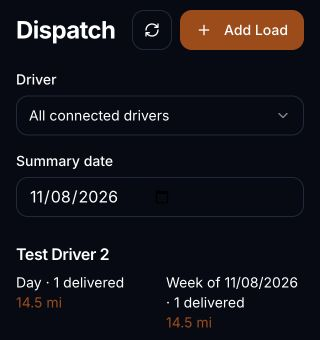
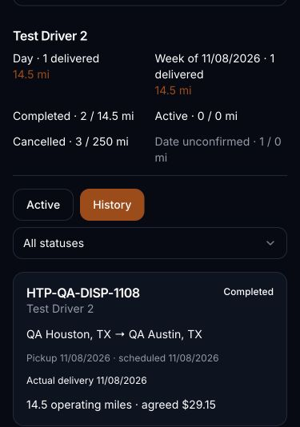

# Dispatcher Mini App: acceptance and release ledger

Status: **PRODUCTION DEPLOYED. Owner Dispatch QA passed on 2026-11-08.**
Separate live staff-account and browser report-download journeys remain unverified.

Starting production source: `8938880087a7e4ec3ed9527003b49dfc29fd8b05`.
Initial implementation: `149158282b410e08fa0cfd38ec84d3148d68f9b5`.
Independently tested source: `d231ee3d0e87fb54a63bba3e72fd70a757ddae5e`.
Independent corrections and evidence are on `codex/dispatcher-mini-app`.
The exact resulting commit is the review branch head shown in GitHub.

## Implemented behavior

- Dispatch home entry, active/history lists, driver/status filters and pagination.
- Reviewed load entry with deterministic paste extraction, manual correction,
  connected-driver selection, shared mileage/pay rules and exact decimal cents.
- New loads use the canonical driver record and start Pending.
- Delivered and Cancel Load require explicit confirmation. Delivery captures an
  actual delivery date; scheduled dates and historical financial fields remain intact.
- Daily/weekly delivered load counts and operating miles, with separate active,
  cancelled and completed-with-unconfirmed-date counts. Week boundaries follow
  the workspace setting; summary totals cover all matching rows across pages.
- Connected-group help includes a private-bot Open Dispatch entry. Exact private
  `/start dispatch` opens the signed Mini App sign-in/access surface, including
  for dispatch-only staff without opportunity-viewing permission.

## Authority and data boundaries

| Caller | View | Create | Change status |
| --- | --- | --- | --- |
| Workspace owner | Existing canonical permission resolution | Existing resolution | Existing resolution |
| Active staff | `loads_view` | `loads_view` and `loads_dispatch` | `loads_view` and `loads_update_status` |
| Mini App entry with an unlinked Telegram account, unrelated or revoked account | Denied | Denied | Denied |
| Driver or delegated-driver context without recruiter membership | Denied | Denied | Denied |

The current signed Telegram launch, HaulTracker sign-in, account link and
workspace-selection checks remain authoritative. Entry links grant no business
permission. Browser reads/writes use scoped RPCs. The existing loads table,
relationships, receipts and append-only events are reused. No table, column,
enum, role, direct-table RLS policy or table grant is added or broadened.

The reviewed SQL candidate, applied on 2026-11-08, is
`supabase/migration-candidates/20261108140123_dispatcher_mini_app.sql`.
It adds `dispatch_mini_assert_scope`, `dispatch_mini_read`,
`dispatch_mini_create` and `dispatch_mini_status`, with fixed search paths,
explicit authentication/permissions/relationship checks and no anonymous EXECUTE.
Canonical creation and status functions are called without replacing their bodies.
Actual delivery dates and exact retry intents are appended to load events.

## Independent review corrections

- References now match the group parser exactly; underscores and terminal hyphens
  are rejected by the UI and server.
- The actual connected-group help feedback branch now sends the Dispatch button.
- Replacing pasted text clears old extracted routes, dates and mileage. Source,
  requirements and multi-stop information remain available in review notes.
- Decimal inputs are calculated before rounding: `14.5 × 2.01 = 29.145`, recognized
  as `29.15`; original numeric components are retained. Preview and submitted pay agree.
- Exact retries reuse the same key and payload. Fresh keys cannot create another
  load with the same group-visible reference in an active workspace relationship.
- Transient read errors hide private results and disable actions while preserving
  typed form state. Explicit denial clears authority. Old-account responses are discarded.
- The private Dispatch entry reaches the Mini App independently of the older
  opportunity-only bot workspace resolver. Data access remains permission gated.

## Verification

| Check | Result |
| --- | --- |
| Focused Dispatch, Mini App, parser/pay and group suites | PASS: 476 tests in 20 files |
| Existing recruiter bot and guidance regression | PASS: 235 tests in 8 files |
| Distinct source checks including native concurrency | 20 + 8 = 28 files; 476 + 235 + 5 additional concurrent cases = 716 passed tests |
| Production frontend build | PASS; existing large-chunk warning retained |
| App and build-config TypeScript checks | PASS |
| Targeted production-screen lint | PASS |
| Independent live-schema PostgreSQL/WASM fixture | PASS: canonical create, exact cents, retries, duplicate references, actor/tenant denial, atomic date audit, stale status, all-page summaries and permission revocation |
| Isolated browser: 320, 375, 1280 px | PASS: save after simulated lost response, delivery, close-without-cancel, confirmed cancellation, history, view-only/denied access; no horizontal overflow or page errors |
| Native PostgreSQL 17.11 | PASS: 26/26, zero skipped; 21 SQL cases repeated plus five additional concurrent transaction cases |
| GitHub verification | PASS: Telegram Mini App verification and Recruiter Paid Entitlement Postgres gate on tested source revision |
| Production SQL and site/poller rollout | PASS: applied and deployed on 2026-11-08; live behavior verified below |
| Live owner/group Dispatch journey | PASS: one registered QA driver/load, creation through delivery and history |
| Separate live staff-account journey | NOT RUN: the existing QA workspace has only its active owner membership |

The browser served local production-build assets with synthetic API and Telegram
launch responses. Every external request was intercepted. Its writes and screenshots
contain synthetic QA data, not customer records. The separate PostgreSQL/WASM check
used the inspected production table metadata and exact production dispatch function
definitions with synthetic rows. It does not prove production triggers or concurrent
transactions. The native test transport uses a disposable local cluster and never
accepts a configured production database URL.


Reproduction commands (synthetic public configuration only):

```sh
VITE_SUPABASE_URL=https://pngptztxwbtozwxrtbwo.supabase.co VITE_SUPABASE_PUBLISHABLE_KEY=synthetic-unit-test-key HTP_TEST_PGLITE=1 npm test -- --maxWorkers=2 src/test/dispatchWorkspace src/test/telegramMiniApp src/test/phaseTGG1DispatchGroupProposals.test.ts src/test/phaseTGG1BDispatchReviewQueue.test.ts src/test/phaseSprint1TelegramDispatchGuidance.test.ts src/test/phaseTG2DTelegramPollingIntakeFoundation.test.ts src/test/phaseTGG1CStagedPoller.test.ts src/test/pasteLoadRepairBundle.test.ts src/test/computeLoadPay.test.ts src/test/loadMetrics.test.ts
npm test -- --maxWorkers=2 src/test/phaseRB1 src/test/phaseRB3 src/test/phaseUX1TelegramBotGuidance.test.ts
npm exec tsc -- -p tsconfig.app.json --noEmit
npm exec tsc -- -p tsconfig.node.json --noEmit
npm exec eslint -- src/components/telegram src/hooks/useDispatchWorkspace.ts src/lib/dispatchWorkspace.ts src/lib/telegramMiniApp.ts
```

`HTP_TEST_PGLITE=1` runs real PostgreSQL/WASM without sockets; the five separate-session
concurrency probes are explicitly skipped. Unset it on an isolated native PostgreSQL
16/17 executor to run those probes. No project dependencies were changed.

## Release approval and remaining acceptance

Source acceptance and the owner-approved production rollout are complete. The owner
approved merging PR #53, applying the exact candidate, deploying the Telegram poller,
publishing the frontend and one acceptance run in the existing QA workspace/group.
The owner/group run and denied-driver server checks are recorded below. Separate
staff-account and driver-browser report-download checks remain unverified. No new
group, account, role, delegation, paid AI, billing change, dispatch-lane change or
customer-load correction was made. Only the labeled QA load and routine QA bot
commands were written during the live acceptance run.

Multi-stop content is retained as notes; stop-by-stop tracking is outside this view.
Legacy completed loads without confirmed delivery dates are not backfilled.
The existing driver financial/report/CSV calculations passed with the live QA row
read under that driver's existing RLS. A browser download from a signed-in QA driver
session was not exercised; the owner has no approved driver delegation for this fixture.

Reported implementation/test-only credits: 14.518 + 0.500 + 1.300 = 16.318.
The 0.500 test attempt stopped at an environment restriction and ran no tests; the
final native gate used a private disposable fixture with verified public source
hashes and no Git operations. Independent corrections were made directly in the
review branch; no duplicate implementation run was sent. These are API-reported
costs, not an independently reconciled billing statement.

## Native and production readback evidence

The native run verified SHA-256 for its exact input files before execution:

| Input | SHA-256 |
| --- | --- |
| `src/lib/dispatchWorkspace.ts` | `15d5725a8c1d9a667f3e4516be3a5e205f8a86155fff2ad3c65e6c7deb4d70a8` |
| `src/test/dispatchWorkspacePostgres.test.ts` | `75227c67cf0149ba73fafb39a5bb8229e3502a2bf105e8bc4825259dacd681ca` |
| Candidate SQL | `9c71f7bafb473d8a5f51ffa46ec57deae669ee1cc55cf44d016ffb3e90a688fb` |

All 26 native cases passed, including exact and conflicting duplicate creation,
fresh-key/same-reference creation, duplicate status confirmation and competing
terminal statuses. The disposable cluster and temporary fixture were removed.
The source inputs and canonical authorization bodies match those reviewed here.

Read-only production checks before rollout confirmed:

- `/version.json` still identifies frontend `8938880087a7e4ec3ed9527003b49dfc29fd8b05`.
- All four inspected canonical dispatch/mileage function definitions match the baseline.
- None of the four new `dispatch_mini_*` functions are installed in production.
- Lovable source main remains `149158282b410e08fa0cfd38ec84d3148d68f9b5`; review corrections are in PR #53.

No production acceptance is inferred from these preservation checks.

## Production rollout evidence: 2026-11-08

PR [#53](https://github.com/berthony01/haultrackerpro/pull/53) merged as
`44a162f220de937171cd28888fce3eef8f4ca7e5`. Both the custom domain and provider host
returned that exact SHA in `/version.json`, built at `2026-11-08T20:08:49.722Z`.
Frontend deployment receipt: `95badc27-409c-4323-917d-4d1f445de456`.

The exact candidate SHA-256 remains
`9c71f7bafb473d8a5f51ffa46ec57deae669ee1cc55cf44d016ffb3e90a688fb`.
All four installed bodies matched the reviewed candidate before and after live QA:

| Function | Live body MD5 |
| --- | --- |
| `dispatch_mini_assert_scope` | `043e2d91452ec9a4d2ff40090ecd2977` |
| `dispatch_mini_read` | `8a94f7ddbd593b55a26e74d811986b2c` |
| `dispatch_mini_create` | `b49b8361cdf55f41413fc9f445a2bf87` |
| `dispatch_mini_status` | `d28b373267834c319495c98c6b90fbae` |

Each new function is SECURITY DEFINER with `search_path=pg_catalog`, authenticated
EXECUTE enabled and anon EXECUTE disabled. The four existing canonical mileage,
authorization, create and status bodies still match their recorded baselines.

The provider returned `Successfully deployed edge functions: telegram-poll`.
The deployment tool did not expose the running version/timestamp or deployed code;
those metadata are unverified. Runtime checks did confirm the new group Open Dispatch
entry and exact private `/start dispatch` response, followed by a signed Mini App
launch into the existing owner's workspace. Group help still reports load updates on.
The existing lane settings were not changed.

The SQL application caused 43 generated type lines to be added in
`src/integrations/supabase/types.ts`, then synced as
`7679ce7977c9549fce56d37745f8787694e1ce2f`. Independent Git comparison confirmed this
is the only file differing from the approved merge. All deployed function sources
are byte-identical to the reviewed merge. The published frontend remains the exact
reviewed merge. No application or function source correction was introduced during rollout.

### One live QA load

The pre-existing Test Carrier workspace and Test Driver 2 were confirmed as active
registered QA fixtures. Reference `HTP-QA-DISP-1108` did not exist before the run.
The run created exactly one canonical driver load using the signed Mini App.

| Live check | Result and evidence |
| --- | --- |
| Group `/help@HaulTrackerBot` | PASS: connected, load updates on, new Open Dispatch button |
| Group deep link and exact private command | PASS: Dispatch-specific private entry and signed Mini App |
| Owner workspace and connected driver | PASS: existing Test Carrier owner and Test Driver 2, no relinking |
| Paste and review | PASS for safe review: reference, dates and miles extracted; ambiguous route/rate fields warned and manually corrected before save |
| Pending creation | PASS: one new row, assigned to the existing QA driver's active carrier relationship |
| Exact agreed pay and raw components | PASS: `14.5 × 2.01 = 29.145`, rounded to `$29.15`; miles and rate preserved |
| Open cancellation, then Keep unchanged / Close | PASS: row remained Pending, no status event |
| Confirm Delivered with no date | PASS: blocked with date-required guidance; row still Pending, no status event |
| Confirm Delivered with `2026-11-08` | PASS: Completed, one Mini App delivery event, actual delivery date recorded |
| Scheduled dates and money preserved | PASS: pickup/scheduled delivery both remain `2026-11-08`; miles/rate/pay unchanged |
| Active and History | PASS: load leaves Active and appears Completed in History with actual date and `$29.15` |
| Daily and weekly summaries | PASS: each changes from 0 delivered / 0 mi to 1 delivered / 14.5 mi |
| Live 320 and 375 px | PASS: signed Mini App summaries/history fit; document clientWidth equals scrollWidth at each width |
| Legacy completion handling | PASS: older completion remains Date unconfirmed; no backfill |
| Existing QA rows | PASS: all five older QA rows retain status/update-time fingerprint `315f4714b088dd699fd4594c3d86811e` |
| Driver data access | PASS: production authenticated-role SQL context can read its own new load through existing RLS |
| Denied-driver dispatch | PASS: all three canonical dispatch permission checks false; new read RPC rejects with insufficient_privilege |
| Existing report and CSV calculations | PASS: actual QA row through unchanged production modules gives 1 completed, 14.5 mi, `$29.15` expected/gross, `$0` recorded pay, `$29.15` unpaid; CSV detail agrees; input unchanged |

The production permission probes used transaction-local authenticated-role/subject
settings and ended with ROLLBACK. No account permissions or data were changed by
those probes. The report/CSV parity check executed the actual unchanged modules
locally with the production QA row read through the driver's RLS. It was not a
browser report-download test. Only QA data was used in the parity calculation.

The signed Mini App was reopened in another normal Telegram browser tab and returned
the persisted summary. At actual iframe widths of 320 and 375 px, document
clientWidth and scrollWidth matched each width. The 375 px History view also showed
the completed QA load, actual delivery date and agreed pay. The temporary browser
viewport override was reset. These crops contain only the QA dispatch view.





Live cancellation commitment was not repeated on a second fixture; one terminal
delivery was used for this one-load acceptance run. Cancellation writes and retries
already passed the isolated browser and native PostgreSQL gates above. Separate
staff and revoked-account browser launches were not repeated in this rollout;
the earlier isolated tests remain the evidence for those cases.

A website tab already open before publication encountered a dynamic-import fetch
failure when opening Assistant Access Center. Its normal Reload App action recovered
the page. No assistant/delegation changes were made, and the Dispatch run was not
affected. The owner has zero approved managed drivers in that access center.

API-reported rollout agent credits: `2.300` for the bot-only deployment and readback.
Previously reported implementation/test credits `16.318 + 2.300 = 18.618` in total.
This is the reported agent cost, not an independently reconciled billing statement.
