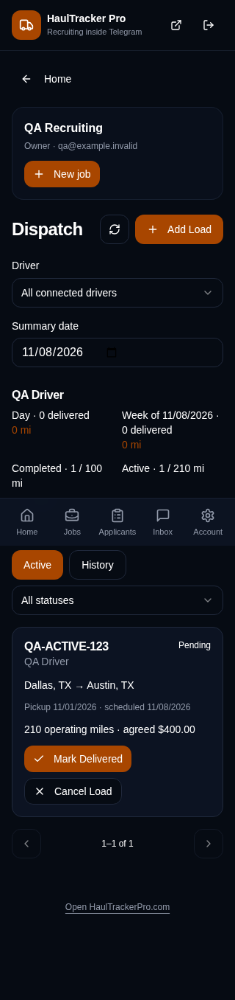
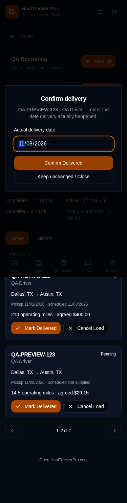

# Dispatcher Mini App: acceptance and release ledger

Status: **STAGED. Production rollout has not been performed.**

Starting production source: `8938880087a7e4ec3ed9527003b49dfc29fd8b05`.
Initial implementation: `149158282b410e08fa0cfd38ec84d3148d68f9b5`.
Independently tested source: `d231ee3d0e87fb54a63bba3e72fd70a757ddae5e`.
Independent corrections and evidence are on `codex/dispatcher-mini-app`.
The exact resulting commit is the review branch head shown in GitHub.

## Implemented behavior

- Dispatch home entry, active/history lists, driver/status filters and pagination.
- Reviewed load entry with deterministic paste extraction, manual correction,
  connected-driver selection, shared mileage/pay rules and exact decimal cents.
- New loads use the canonical driver record and start Pending.
- Delivered and Cancel Load require explicit confirmation. Delivery captures an
  actual delivery date; scheduled dates and historical financial fields remain intact.
- Daily/weekly delivered load counts and operating miles, with separate active,
  cancelled and completed-with-unconfirmed-date counts. Week boundaries follow
  the workspace setting; summary totals cover all matching rows across pages.
- Connected-group help includes a private-bot Open Dispatch entry. Exact private
  `/start dispatch` opens the signed Mini App sign-in/access surface, including
  for dispatch-only staff without opportunity-viewing permission.

## Authority and data boundaries

| Caller | View | Create | Change status |
| --- | --- | --- | --- |
| Workspace owner | Existing canonical permission resolution | Existing resolution | Existing resolution |
| Active staff | `loads_view` | `loads_view` and `loads_dispatch` | `loads_view` and `loads_update_status` |
| Mini App entry with an unlinked Telegram account, unrelated or revoked account | Denied | Denied | Denied |
| Driver or delegated-driver context without recruiter membership | Denied | Denied | Denied |

The current signed Telegram launch, HaulTracker sign-in, account link and
workspace-selection checks remain authoritative. Entry links grant no business
permission. Browser reads/writes use scoped RPCs. The existing loads table,
relationships, receipts and append-only events are reused. No table, column,
enum, role, direct-table RLS policy or table grant is added or broadened.

The unapplied SQL candidate is
`supabase/migration-candidates/20261108140123_dispatcher_mini_app.sql`.
It adds `dispatch_mini_assert_scope`, `dispatch_mini_read`,
`dispatch_mini_create` and `dispatch_mini_status`, with fixed search paths,
explicit authentication/permissions/relationship checks and no anonymous EXECUTE.
Canonical creation and status functions are called without replacing their bodies.
Actual delivery dates and exact retry intents are appended to load events.

## Independent review corrections

- References now match the group parser exactly; underscores and terminal hyphens
  are rejected by the UI and server.
- The actual connected-group help feedback branch now sends the Dispatch button.
- Replacing pasted text clears old extracted routes, dates and mileage. Source,
  requirements and multi-stop information remain available in review notes.
- Decimal inputs are calculated before rounding: `14.5 × 2.01 = 29.145`, recognized
  as `29.15`; original numeric components are retained. Preview and submitted pay agree.
- Exact retries reuse the same key and payload. Fresh keys cannot create another
  load with the same group-visible reference in an active workspace relationship.
- Transient read errors hide private results and disable actions while preserving
  typed form state. Explicit denial clears authority. Old-account responses are discarded.
- The private Dispatch entry reaches the Mini App independently of the older
  opportunity-only bot workspace resolver. Data access remains permission gated.

## Verification

| Check | Result |
| --- | --- |
| Focused Dispatch, Mini App, parser/pay and group suites | PASS: 476 tests in 20 files |
| Existing recruiter bot and guidance regression | PASS: 235 tests in 8 files |
| Distinct source checks including native concurrency | 20 + 8 = 28 files; 476 + 235 + 5 additional concurrent cases = 716 passed tests |
| Production frontend build | PASS; existing large-chunk warning retained |
| App and build-config TypeScript checks | PASS |
| Targeted production-screen lint | PASS |
| Independent live-schema PostgreSQL/WASM fixture | PASS: canonical create, exact cents, retries, duplicate references, actor/tenant denial, atomic date audit, stale status, all-page summaries and permission revocation |
| Isolated browser: 320, 375, 1280 px | PASS: save after simulated lost response, delivery, close-without-cancel, confirmed cancellation, history, view-only/denied access; no horizontal overflow or page errors |
| Native PostgreSQL 17.11 | PASS: 26/26, zero skipped; 21 SQL cases repeated plus five additional concurrent transaction cases |
| GitHub verification | PASS: Telegram Mini App verification and Recruiter Paid Entitlement Postgres gate on tested source revision |
| Production SQL, poller/site rollout, live owner/staff/group journey | NOT RUN |

The browser served local production-build assets with synthetic API and Telegram
launch responses. Every external request was intercepted. Its writes and screenshots
contain synthetic QA data, not customer records. The separate PostgreSQL/WASM check
used the inspected production table metadata and exact production dispatch function
definitions with synthetic rows. It does not prove production triggers or concurrent
transactions. The native test transport uses a disposable local cluster and never
accepts a configured production database URL.





Reproduction commands (synthetic public configuration only):

```sh
VITE_SUPABASE_URL=https://pngptztxwbtozwxrtbwo.supabase.co VITE_SUPABASE_PUBLISHABLE_KEY=synthetic-unit-test-key HTP_TEST_PGLITE=1 npm test -- --maxWorkers=2 src/test/dispatchWorkspace src/test/telegramMiniApp src/test/phaseTGG1DispatchGroupProposals.test.ts src/test/phaseTGG1BDispatchReviewQueue.test.ts src/test/phaseSprint1TelegramDispatchGuidance.test.ts src/test/phaseTG2DTelegramPollingIntakeFoundation.test.ts src/test/phaseTGG1CStagedPoller.test.ts src/test/pasteLoadRepairBundle.test.ts src/test/computeLoadPay.test.ts src/test/loadMetrics.test.ts
npm test -- --maxWorkers=2 src/test/phaseRB1 src/test/phaseRB3 src/test/phaseUX1TelegramBotGuidance.test.ts
npm exec tsc -- -p tsconfig.app.json --noEmit
npm exec tsc -- -p tsconfig.node.json --noEmit
npm exec eslint -- src/components/telegram src/hooks/useDispatchWorkspace.ts src/lib/dispatchWorkspace.ts src/lib/telegramMiniApp.ts
```

`HTP_TEST_PGLITE=1` runs real PostgreSQL/WASM without sockets; the five separate-session
concurrency probes are explicitly skipped. Unset it on an isolated native PostgreSQL
16/17 executor to run those probes. No project dependencies were changed.

## Remaining release gate

Source acceptance is complete. Review approval for applying this exact candidate,
deploying the affected Telegram poller and publishing the frontend.
Rollout must include authenticated owner/staff/denied-account checks and one
clearly labeled QA load in the existing QA workspace/group, with live persistence
readbacks. No additional group, paid AI, billing change, general-dispatch activation,
customer-load correction or live message has been performed in this implementation.

Multi-stop content is retained as notes; stop-by-stop tracking is outside this view.
Legacy completed loads without confirmed delivery dates are not backfilled.
The existing driver financial/export workflows still need scoped live parity checks
for a newly created dispatch load before production acceptance.

Reported implementation/test-only credits: 14.518 + 0.500 + 1.300 = 16.318.
The 0.500 test attempt stopped at an environment restriction and ran no tests; the
final native gate used a private disposable fixture with verified public source
hashes and no Git operations. Independent corrections were made directly in the
review branch; no duplicate implementation run was sent. These are API-reported
costs, not an independently reconciled billing statement.

## Native and production readback evidence

The native run verified SHA-256 for its exact input files before execution:

| Input | SHA-256 |
| --- | --- |
| `src/lib/dispatchWorkspace.ts` | `15d5725a8c1d9a667f3e4516be3a5e205f8a86155fff2ad3c65e6c7deb4d70a8` |
| `src/test/dispatchWorkspacePostgres.test.ts` | `75227c67cf0149ba73fafb39a5bb8229e3502a2bf105e8bc4825259dacd681ca` |
| Candidate SQL | `9c71f7bafb473d8a5f51ffa46ec57deae669ee1cc55cf44d016ffb3e90a688fb` |

All 26 native cases passed, including exact and conflicting duplicate creation,
fresh-key/same-reference creation, duplicate status confirmation and competing
terminal statuses. The disposable cluster and temporary fixture were removed.
The source inputs and canonical authorization bodies match those reviewed here.

Read-only production checks after implementation confirmed:

- `/version.json` still identifies frontend `8938880087a7e4ec3ed9527003b49dfc29fd8b05`.
- All four inspected canonical dispatch/mileage function definitions match the baseline.
- None of the four new `dispatch_mini_*` functions are installed in production.
- Lovable source main remains `149158282b410e08fa0cfd38ec84d3148d68f9b5`; review corrections are in PR #53.

No production acceptance is inferred from these preservation checks.
