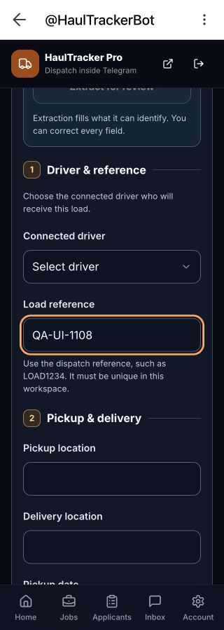
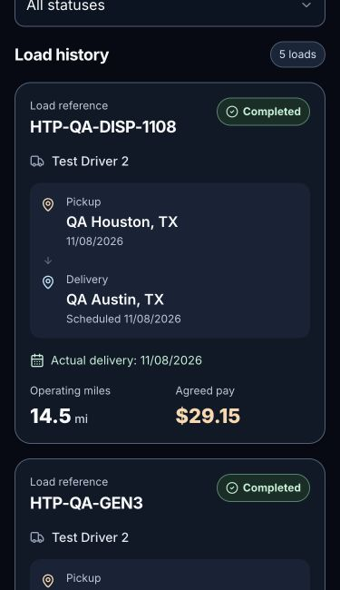

# Dispatch refresh stability and readability

Status: **PRODUCTION PUBLISHED. Scoped live owner refresh and mobile QA passed.**

Starting source: `71fea0291a48f0ff662b83d3a7cd3dc31008f993`.
Candidate branch: `codex/dispatch-stability-polish`.

## Confirmed cause

The Dispatch hook starts a read every 15 seconds and on focus/visibility events.
It sets `loading=true` while retaining the existing same-account page. The old
screen then omitted summaries and load cards whenever `loading` was true. This
removed visible content on each routine check, producing a repeatable flicker.
Overlapping focus and visibility events also started duplicate permission reads
and invalidated earlier responses. Two new regression tests failed on the original
source: the visible load disappeared, and a burst made four permission reads where
one initial read plus one recheck was expected.

This is a confirmed source-level cause, not a claim that every possible blank
screen has the same cause. The current live browser had no matching app error logs
in the inspected sample; intermittent device/network failures are not ruled out.

## Change

- Keep the existing load cards and summaries mounted during a same-account,
  same-filter background read. A fixed-height update message explains the check.
- Coalesce matching in-flight reads. Pause polling while the document is hidden
  and recheck on return. Confirmed writes force a newer read rather than reusing a
  read that began before the write.
- Clear old results on filter/account changes. Server denial still clears private
  content and authority. Transient errors still hide private content, retain the
  inactive draft and show a visible Retry message. Write actions remain disabled
  until current permissions have been verified.
- Group the form into Driver & reference, Pickup & delivery, Miles and Agreed pay.
  Preserve extraction warnings, editable fields, source notes and exact retry intents.
- Use larger fields/buttons, distinct primary/secondary/delivery/cancellation
  colors, clear focus outlines and explicit button text. Optional fees have a
  labelled disclosure. A separate review panel summarizes the load before saving.
- Present posted loads with a status badge, separate pickup/delivery blocks,
  actual-delivery label, larger agreed pay/mileage and visible status actions.
- Make daily/weekly totals easier to scan and move secondary totals into a
  labelled disclosure. Condense the workspace banner and omit the unrelated New
  job button only while viewing Dispatch. Label the header Dispatch inside Telegram.

No SQL, database policy, authorization map, account link, bot command, AI setting,
billing setting, financial calculation or dependency was changed. No production
load was created or updated by this task.

## Verification

| Check | Result |
| --- | --- |
| Regression reproduction on original code | PASS: both new cases failed as expected |
| Dispatch, Mini App access/navigation/posting/privacy suites | PASS: 142 tests in 9 files |
| Overlapping read coalescing | PASS |
| Forced refresh after a confirmed mutation | PASS: late older response cannot restore stale data |
| Filter/account changes and explicit denial | PASS: old data is hidden/cleared |
| Hidden polling and resume | PASS |
| Draft retention during background refresh and temporary failure | PASS |
| Exact create/status retry, date validation and view-only restrictions | PASS |
| App and build-config TypeScript | PASS |
| Targeted source lint | PASS |
| Production build | PASS; existing large-chunk warning retained |
| Manual visual rendering at 320/375 px | PASS: live form/history, no horizontal overflow, fields and form actions at least 48 px high |
| Production deployment / scoped owner UI acceptance | PASS: both live hosts serve `7215541b2e6ce554a36dd5413d83adf3c08941ea` |

An interactive review HTML file was prepared from the actual Dispatch components
and built production CSS, with a synthetic hook and synthetic load records. Its
Content Security Policy disables network access. It contains no live account,
credentials or production writes. It demonstrates layout and local interactions,
not signed Telegram authentication or real database persistence.

Before release, the browser did not grant access to a data preview URL or the
ChatGPT review-file host. After owner publication approval, the ordinary production
Telegram entry was used for the live checks below. No browser-policy workaround or
alternate browser was used. No Lovable development turn was requested.

Reproduction: run the nine named suites from `dispatch-polish-final-tests.log`
with the existing synthetic public test configuration; app/node `tsc --noEmit`,
targeted ESLint and `vite build`. The log is an intermediate local record; source
and this ledger are preserved in the review branch.

## Approved production rollout

PR [#54](https://github.com/berthony01/haultrackerpro/pull/54) merged as
`0b004128516a19769cc321abb52e9df6f4a7fcb3` after both GitHub verification workflows
passed on the exact candidate. The merged tree matched the tested candidate.
Mobile review then caught singular-count wording/spacing and the ambiguity of
Today/This week when choosing a historical summary date. Small display-only
corrections use `1 load` and neutral Daily deliveries/Weekly deliveries labels.
The nine component cases were rerun successfully and the count-spacing build passed.
No permission, refresh, financial, SQL or bot behavior changed in those corrections.

Final published source: `7215541b2e6ce554a36dd5413d83adf3c08941ea`.
Both `haultrackerpro.com/version.json` and the provider host returned this SHA,
built at `2026-11-08T21:39:29.304Z`.
Final deployment receipt: `95843ba2-d19e-40d9-a22a-603a43509e75`.

| Live check | Evidence |
| --- | --- |
| Owner entry | Existing signed Telegram account opened the existing QA Test Carrier workspace |
| Background refresh stability | 17 DOM observations over 44.042 seconds; QA load and summary present in every sample, Updating state observed, no alert in any sample |
| Draft retention | Unsaved QA reference `QA-UI-1108` stayed present and unchanged over a separate 22.857-second observation; no save submitted |
| 375 px history | Document width and scrollWidth both 375; existing Completed QA load showed actual delivery, 14.5 mi and $29.15 |
| 320 px form | Document width and scrollWidth both 320; inspected fields 48 px high and form actions 48 px or taller |
| Final copy readback | Fresh signed launch showed Daily deliveries, Weekly deliveries and singular load labels |
| Existing load | `HTP-QA-DISP-1108` remained Completed with actual delivery 11/08/2026 and agreed pay $29.15 |
| Data boundary | Read-only business-data checks; no load, status, role, link, billing or AI write was submitted |
| Browser cleanup | Temporary viewport override reset; the task-created QA draft was discarded by reload for final-version verification |

The continuous refresh and draft observations were performed on the first published
revision. The final follow-up changed only display labels and summary number spacing;
fresh final-version history and label readbacks passed. The 320 px form component
and its field/action styles were identical between these revisions.

These checks cover the reported refresh flicker and scoped owner presentation.
They do not claim that every possible device/network blank-screen cause was reproduced.
The earlier separate staff-account and driver-download acceptance items remain
outside this frontend repair. No extra customer load or role fixture was introduced.

Single next action: finish any unsaved form, then reopen the Mini App to load the
published update.
